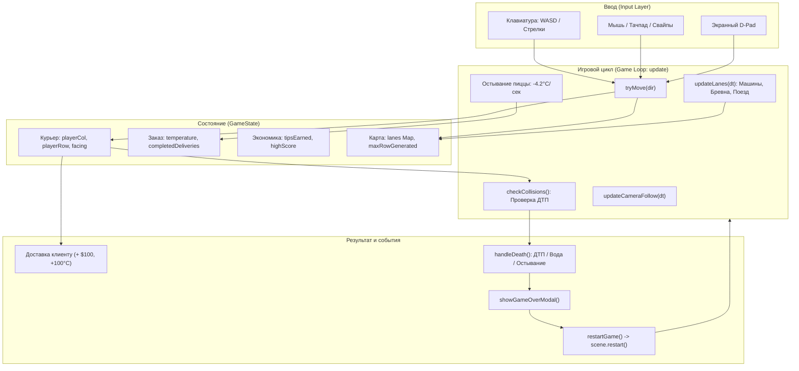

# 📔 Дневник разработки и архитектурная документация

Проект: **CYBER COURIER: Hot Delivery**  
Стек: **TypeScript, Phaser 3/4, Vite, Web Audio API**  
Репозиторий: учебный проект для курса разработки игровых приложений.

---

## 🎯 Часть 1. Экспресс-анализ: «Где живёт ваша игра? 5 ключевых точек»

Ответы на контрольные вопросы архитектурного анализа кодовой базы (без изменения кода, точная привязка: файл + функция / участок кода).

```
   ┌──────────────────────────────────────────────────────────────────┐
   │ 1. ВВОД (Input)        ──► GameScene.ts: handleKeyboard, Pointer │
   │ 2. СОСТОЯНИЕ (State)   ──► GameScene.ts: поля класса GameScene   │
   │ 3. РЕЗУЛЬТАТ (Outcome) ──► GameScene.ts: handleDeath / Delivery  │
   │ 4. ПЕРЕЗАПУСК (Reset)  ──► GameScene.ts: restartGame / create    │
   │ 5. ПРАВИЛА (Rules)     ──► GameScene.ts: Константы L4-18, L340   │
   └──────────────────────────────────────────────────────────────────┘
```

---

### Точка 1. ВВОД — Где обрабатывается управление?

- **Файл**: [`src/game/GameScene.ts`](file:///c:/Users/ivanu/OneDrive/Рабочий%20стол/game/src/game/GameScene.ts)
- **Функции и участки кода**:
  1. **Инициализация слушателей ввода**:
     - Метод `create()` — строки **153–168**:
       - Настройка курсорных стрелок (`this.cursors`)
       - Настройка WASD клавиш (`this.wasd`)
       - Регистрация клавиши `SPACE` (`this.spaceKey`)
       - Регистрация клавиш паузы `P` и `ESC` (`this.pauseKey`, `this.escKey`)
       - Вызов `this.setupPointerControls()`
  2. **Опрос клавиатуры каждый кадр (Game Loop)**:
     - В начале `update()` — проверка клавиш `P` / `ESC` для вызова `togglePause()`.
     - Метод `handleKeyboard()`:
       - Проверка `Phaser.Input.Keyboard.JustDown` для стрелок и WASD
       - Вызов метода перемещения `tryMove('up' | 'down' | 'left' | 'right')`
     - Вызывается внутри `update()` (если игра не на паузе).
  3. **Обработка мыши, сенсорного экрана и жестов (Тач / Свайпы)**:
     - Метод `setupPointerControls()`:
       - `pointerdown`: фиксация точки нажатия (`touchStartX`, `touchStartY`)
       - `pointerup`: если дистанция > 25px — вычисление направления свайпа и вызов `tryMove(dir)`. Если короткий тап — прыжок в направлении взгляда (`tryMove(this.playerFacing)`).
  4. **Экранный виртуальный D-Pad и кнопки HUD**:
     - Метод `createDPad()`: экранные кнопки со стрелками в углу для комфортной игры на смартфонах.
     - Кнопка паузы `pauseBtnText` (`⏸`) в правом верхнем углу HUD (`togglePause()`).
  5. **Исполнение хода / проверка проходимости**:
     - Метод `tryMove(dir)`: валидация координат, блокировка во время прыжка/паузы/смерти, коллизии с препятствиями, запуск звука `playHop()`.

---

### Точка 2. СОСТОЯНИЕ ИГРЫ — Где оно хранится?

- **Файл**: [`src/game/GameScene.ts`](file:///c:/Users/ivanu/OneDrive/Рабочий%20стол/game/src/game/GameScene.ts)
- **Функции и участки кода**:
  1. **Оперативное состояние текущей игровой сессии** — поля класса `GameScene`:
     - **Позиция и статус курьера**:
       - `playerCol: number` (текущая колонка на сетке, 0..15)
       - `playerRow: number` (текущий ряд мира, продвижение вперед)
       - `isHopping: boolean` (флаг анимации прыжка)
       - `isDead: boolean` (флаг поражения)
       - `isPaused: boolean` (флаг паузы с остановкой мира, остывания заказа и твинов)
       - `playerFacing: 'up' | 'down' | 'left' | 'right'` (направление взгляда)
       - `currentRidePlatform: HoverPlatform | null` (ссылка на бревно, на котором плывет курьер)
     - **Игровые ресурсы и шкалы**:
       - `temperature: number` (температура заказа от 100°C до 0°C — ключевая шкала)
       - `completedDeliveries: number` (число успешно доставленных заказов)
       - `tipsEarned: number` (накопленные крипто-чаевые в долларах)
       - `maxDistance: number` (максимально достигнутый ряд в текущей попытке)
       - `highScore: number` (абсолютный рекорд дистанции)
     - **Генератор мира**:
       - `lanes: Map<number, Lane>` (карта активных процедурных полос)
       - `maxRowGenerated: number` (максимальный сгенерированный ряд впереди)
  2. **Постоянное состояние (Persistent Storage)**:
     - `localStorage` браузера:
       - `cyber_courier_best_dist` — рекорд дистанции (чтение в строке **121**, запись в строке **1606**)
       - `cyber_courier_tips` — общий баланс денег игрока (чтение в строке **122**, запись в строках **1280** и **1315**)

---

### Точка 3. РЕЗУЛЬТАТ — Где наступает конец игры или победа?

- **Файл**: [`src/game/GameScene.ts`](file:///c:/Users/ivanu/OneDrive/Рабочий%20стол/game/src/game/GameScene.ts)
- **Функции и участки кода**:
  1. **Условия поражения (Game Over)**:
     - **ДТП с транспортом**: метод `checkCollisions()` (строки **1512–1547**) обнаруживает пересечение хитбокса игрока с кибер-машиной или поездом гиперлупа ➔ вызывает `handleCrash(reason)` (строки **1552–1567**).
     - **Падение в энергоканал**: метод `onLand()` (строка **1305**) при приземлении в воду мимо бревна или метод `update()` (строки **1396–1413**) при уплытии за экран ➔ вызывают `handleEnergyFall()` (строки **1569–1583**).
     - **Остывание пиццы до 0°C**: метод `update()` (строки **1381–1384**) проверяет `if (this.temperature <= 0)` ➔ вызывает `handlePizzaFreeze()` (строки **1585–1597**).
  2. **Центральная точка фиксации конца игры**:
     - Метод `handleDeath(reason: string)` (строки **1599–1612**):
       - Устанавливает `this.isDead = true`
       - Воспроизводит звук поражения `soundFx.playGameOver()`
       - Проверяет и обновляет личный рекорд `highScore` в `localStorage`
       - Через таймер 600 мс открывает модальное окно: `showGameOverModal(reason, isNewBest)` (строки **1614–1631**).
  3. **Промежуточная победа (Успешное выполнение цели / Доставка заказа)**:
     - Метод `onLand()` — строки **1267–1270**:
       - Проверяет `if (lane.type === 'delivery_point' && !lane.delivered)`
       - Вызывает `handleDeliveryCompleted(lane)` (строки **1311–1328**):
         - Начисляет +1 к выполненным доставкам
         - Начисляет +$100 в чаевые
         - Выдает новый горячий заказ (`this.temperature = 100`)
         - Запускает праздничные неоновые вспышки и звук победы `playDeliverySuccess()`.

---

### Точка 4. ПЕРЕЗАПУСК — Где сбрасывается состояние?

- **Файл**: [`src/game/GameScene.ts`](file:///c:/Users/ivanu/OneDrive/Рабочий%20стол/game/src/game/GameScene.ts)
- **Функции и участки кода**:
  1. **Инициаторы перезапуска**:
     - Клик по кнопке «ВЗЯТЬ НОВЫЙ ЗАКАЗ» в окне Game Over: `btnZone.on('pointerdown', () => this.restartGame())` (строка **1079**)
     - Нажатие `SPACE` или `W` при активном флаге поражения: метод `update()` (строки **1368–1370**)
     - Метод `restartGame()` (строки **1633–1635**) — вызывает нативный перезапуск сцены Phaser:
       ```typescript
       private restartGame(): void {
         this.scene.restart();
       }
       ```
  2. **Сброс и очистка всех параметров**:
     - Метод `create()` — строки **124–136**:
       ```typescript
       this.lanes.clear();
       this.maxRowGenerated = 0;
       this.maxDistance = 0;
       this.temperature = INITIAL_TEMPERATURE; // 100°C
       this.completedDeliveries = 0;
       this.isDead = false;
       this.isHopping = false;
       this.currentRidePlatform = null;
       this.playerCol = Math.floor(GRID_COLS / 2);
       this.playerRow = 1;
       this.playerFacing = 'up';
       ```
     - Стартовые полосы перегенерируются заново (строки **138–140**).

---

### Точка 5. СЛОЖНОСТЬ, ПОЯВЛЕНИЕ, ПРАВИЛА — Где задаются основные игровые параметры?

- **Файл**: [`src/game/GameScene.ts`](file:///c:/Users/ivanu/OneDrive/Рабочий%20стол/game/src/game/GameScene.ts)
- **Функции и участки кода**:
  1. **Глобальные константы правил и баланса** (строки **4–18**):
     - `TILE_SIZE = 60` — шаг сетки перемещения
     - `GRID_COLS = 16` — ширина игрового поля
     - `HOP_DURATION = 105` — длительность и динамика прыжка (мс)
     - `INITIAL_TEMPERATURE = 100` — стартовая температура заказа
     - `HEAT_DECAY_PER_SEC = 4.2` — скорость остывания пиццы (градусов в секунду)
     - `HEAT_BOOST_ON_FORWARD = 0.8` — подогрев за каждый шаг вперед
     - `CHECKPOINT_INTERVAL = 25` — шаг появления клиентов (каждые 25 рядов)
  2. **Правила процедурного распределения полос**:
     - Метод `generateLane(rowIndex)` (строки **274–333**):
       - Детерминированный псевдослучайный генератор на базе синуса номера ряда (`seed = Math.sin(rowIndex * 41.234) * 83742.12`)
       - Ряды 0–2: безопасные тротуары
       - `rowIndex % CHECKPOINT_INTERVAL === 0`: точка сдачи заказа клиенту
       - Вероятности дорог, энергоканалов и монорельса в зависимости от предыдущей полосы
  3. **Динамическая сложность и параметры препятствий**:
     - Метод `setupCyberLaneVisuals(lane)`:
       - Скорости транспорта: `Phaser.Math.Between(140, 260) * speedScale`
       - Вероятности классов машин: легкие беспилотники (30%), спорткары купе, тяжелые фуры хаулеры
       - Вероятность спавна бонусов на тротуарах: 35% шанс (`itemRoll < 0.35`).
  4. **Игровое время vs Время браузера и Фаза 2** (`PHASE_2_DURATION = 60`):
     - **Вопрос занятия**: *«Что в вашем коде отвечает за игровое время, а что — просто за время браузера?»*
       - **Игровое время (`this.gameTime`)**: накапливается строго через `this.gameTime += dt` внутри игрового цикла `update()`, когда игра **не** находится на паузе (`!this.isPaused`) и игрок жив (`!this.isDead`). Любая пауза замораживает `gameTime`.
       - **Время браузера (`time` / `Date.now()` / `this.time.now`)**: глобальное время от старта страницы, которое тикает непрерывно, даже когда игра на паузе.
     - **Переход в Фазу 2 ровно через 60 игровых секунд**:
       - `triggerPhase2()`: экранный баннер `showPhaseNotification()`, янтарная вспышка камеры и звук `playPhaseChange()`.
        - В Фазе 2 скорость всех машин увеличивается на **+10%** (`phaseSpeedMultiplier = 1.10`, комфортный баланс динамики).
        - **Фикс слипания машин («мега-машина»)**: зацикливание машин и платформ переведено на инвариантный период `roadSpan` и добавлена активная защита от сближения `safeDist`.
       - Поезда гиперлупа начинают ходить в 1.8 раза чаще (интервал 2.5–5.5 с вместо 4.5–9.0 с).
       - В HUD размещена панель с таймером игрового времени `⏱️ 00:00` и бейджем `ФАЗА 1` ➔ `⚡ ФАЗА 2`.
       - При гибели и перезапуске (`restartGame()` ➔ `create()`) время сбрасывается в 0, игра строго возвращается в **Фазу 1**.

---

## 🗺️ Часть 2. Архитектурная карта проекта



---

## 🧠 Часть 3. Навигация через Knowledge Graph (Graphify)

В проекте создан граф знаний архитектуры в каталоге [`graphify-out/`](file:///c:/Users/ivanu/OneDrive/Рабочий%20стол/game/graphify-out):

1. **Интерактивная карта связей**:
   - Откройте в браузере файл [`graphify-out/graph.html`](file:///c:/Users/ivanu/OneDrive/Рабочий%20стол/game/graphify-out/graph.html) для наглядного графа всех методов, полей и переходов.
2. **Консольные запросы к графу**:
   - `python -m graphify query "keyboard input movement"` — трассировка обработки ввода
   - `python -m graphify query "handleDeath game over"` — трассировка условий завершения игры
   - `python -m graphify query "generateLane rules"` — просмотр процедурной генерации
3. **Обновление графа при изменении кода**:
   ```bash
   python -m graphify extract src --out .
   python -m graphify export html
   ```

---

## 📜 Часть 4. Журнал изменений и практических работ

| Дата | Этап / Задача | Что сделано | Файлы |
|---|---|---|---|
| 2026-10-14 | **Практика №1** | Экспресс-анализ архитектуры («5 точек»). Выделение ввода, состояния, исходов, сброса и параметров баланса. Построение графа кода graphify. | `GameScene.ts`, `DIARY.md`, `graphify-out/` |
| 2026-10-14 | **Gray-box Prototype** | Создан сеттинг Cyber Courier: термометр пиццы, точки клиентов, гиперлуп, процедурные энергоканалы, мобильное управление. | `GameScene.ts`, `SoundEffects.ts`, `README.md`, `CHANGELOG.md` |
| 2026-10-14 | **Механика паузы** | Реализована пауза игры: клавиши `P` / `ESC`, экранная кнопка `⏸` в HUD, оверлей со сводкой текущей смены, заморозка таймера остывания заказа, остановка движения транспорта и твинов, процедурный звук `playPause`. | `GameScene.ts`, `SoundEffects.ts`, `README.md`, `DIARY.md` |
| 2026-10-14 | **Фаза 2 (Игровое время)** | Реализовано строгое разделение игрового времени (без учета пауз) и времени браузера. Автоматический переход в Фазу 2 ровно через 60 игровых секунд: всплывающий неоновый баннер-оповещение, ускорение трафика на +35%, учащение поездов гиперлупа, таймер `00:00` и бейдж `⚡ ФАЗА 2` в HUD, звук `playPhaseChange`, сброс в Фазу 1 при рестарте. | `GameScene.ts`, `SoundEffects.ts`, `README.md`, `DIARY.md` |
| 2026-10-14 | **Баланс Фазы 2 и фикс слипания машин** | Ускорение в Фазе 2 скорректировано до +10% (вместо +35%). Устранён баг наложения («мега-машина»): цикл полос переведён на `roadSpan`, добавлена защита anti-bunching. | `GameScene.ts`, `README.md`, `DIARY.md` |


